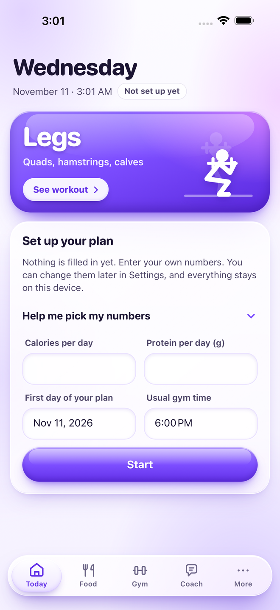
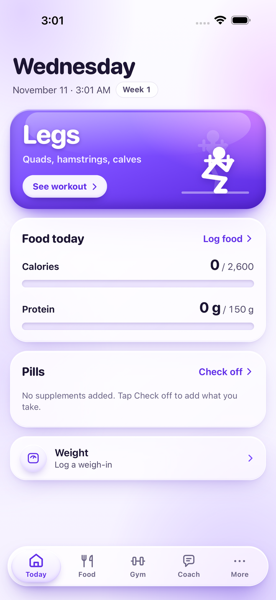
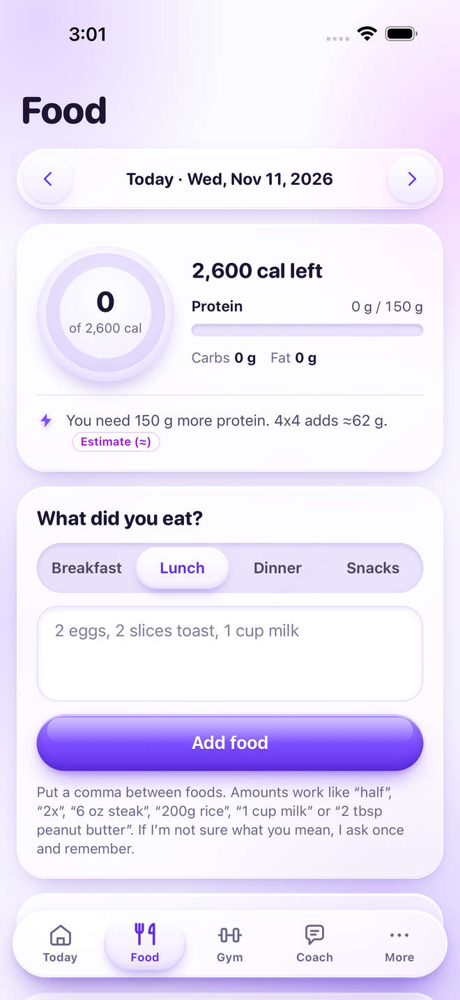
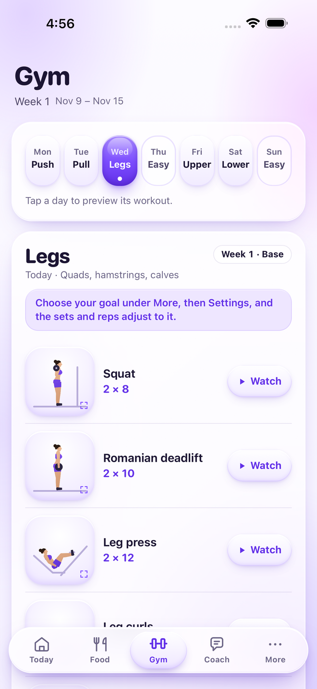

# Gym Planner for iPhone and iPad

A gym, food and supplement tracker that starts completely blank. You enter your own goals, your own
supplements and your own details, and everything stays on your device.

<p>
  
  
  
  
</p>

## What it does

- **Today.** Today's workout, calories and protein so far, supplement reminders and your latest weight.
- **Food log by typing.** Write what you ate the way you would say it ("2 eggs, 1 cup rice, 6 oz steak") and it
  works out calories, protein, carbs and fat. Saved meals, quick add, your own foods from a label, and a
  packaged-food lookup by barcode number or name.
- **Gym plan.** A five-day lifting week (push, pull, legs, upper, lower) with two easy days, on a repeating
  four-week cycle that tells you how many sets to do each week. Every exercise has a drawing and a video link.
- **Supplements.** Add what you take and when (with your first meal, before the gym, after the gym, any time),
  then check them off each day.
- **Weight.** Weigh-ins, a chart and weekly averages, so you judge the trend and not one day.
- **Coach.** A built-in coach answers common training and nutrition questions offline, using your own numbers.
  Optionally add your own Anthropic API key and Claude answers in the app, with your data as context, and can
  look at photos of meals and labels.
- **Backup.** Copy everything as text and paste it back in to restore.

## It starts empty

Nothing about anyone is built in. On first launch the app asks for:

- your calories and protein per day (it can suggest numbers from your age, height, weight and goal, or you type
  your own),
- the first day of your plan and your usual gym time.

Supplements, an optional "About you" note for the coach, and an API key are all things you add yourself later.

## Privacy

- Your logs, settings and API key are stored only on your device. There is no account and no server.
- The app connects to the internet in three cases, all started by you: asking Claude a question (sent to
  Anthropic with your own key), looking up a packaged food (Open Food Facts), and opening a video or source link.
- If you add an API key, your questions and the relevant numbers from the app are sent to Anthropic to get the
  answer. Usage is billed to your own Anthropic account.

This app gives general fitness and nutrition information. It is not medical advice.

## Requirements

- iPhone or iPad with **iOS / iPadOS 15 or later**.
- A way to install an `.ipa` file. The app is not on the App Store and the download is **unsigned**: Apple only
  lets a device run apps signed for it, so the file is signed with your own Apple ID or by a signing service as
  part of installing it.

## Download

**[Download Gym-Planner.ipa](https://github.com/varnealt2-cloud/gym-planner-ios/raw/main/download/Gym-Planner.ipa)**
(version 1.0.0). It is the file produced by the automated build after the tests passed.

## Install

### Without a computer

Use a **signing service**: a paid service that registers your device with an Apple developer account and signs
apps for it from the phone itself, for example **[Signulous](https://www.signulous.com)**.

1. On the iPhone or iPad, buy a plan on the service's site and register the device. Wait until it shows as
   registered; activation can take a while.
2. Download **Gym-Planner.ipa** from the link above. Safari saves it to the Files app, in Downloads.
3. In the service's app or dashboard, upload the `.ipa` and choose **Sign**.
4. Choose **Install**. The Gym Planner icon appears on the Home Screen.
5. If iOS says the developer is not trusted: **Settings → General → VPN & Device Management**, tap the developer
   entry and choose **Trust**.

Prices and reliability of signing services change, so check the service's own site before paying.

### With a Windows PC or a Mac (free)

These tools sign the app with your own Apple ID. With a free Apple ID the app **stops opening after 7 days** and
has to be refreshed (signed again); your data is kept. A paid Apple Developer account makes it last a year.

**[Sideloadly](https://sideloadly.io)**:

1. Install Sideloadly. On Windows, also install iTunes and iCloud from Apple's website (not the Microsoft Store
   versions), as Sideloadly's site explains.
2. Download **Gym-Planner.ipa** to the computer.
3. Connect the device with a cable, unlock it and tap **Trust This Computer**.
4. Drag the `.ipa` into Sideloadly, type your Apple ID and press **Start**.
5. On the device: **Settings → General → VPN & Device Management**, tap your Apple ID and choose **Trust**.
6. On iOS 16 or later, turn on **Settings → Privacy & Security → Developer Mode** and restart when asked.

**[AltStore](https://altstore.io)** and **[SideStore](https://sidestore.io)** also work: install them by
following their guides, download the `.ipa` on the device, then in **My Apps** tap **+** and choose it.

### With a Mac and Xcode

```sh
brew install xcodegen
git clone https://github.com/varnealt2-cloud/gym-planner-ios
cd gym-planner-ios
xcodegen generate
open GymPlanner.xcodeproj
```

Select the GymPlanner target → **Signing & Capabilities**, choose your team, change the bundle identifier to
your own, pick your device and press Run.

## Using it

1. **Set up.** Open the app, enter your calories, protein, start date and gym time, and tap **Start**. Tap
   **Help me pick my numbers** if you want a suggestion.
2. **Log food.** Food tab → type what you ate → **Add food**. Put a comma between foods. Amounts work like
   "half", "2x", "6 oz steak", "200g rice" or "1 cup milk". Tap a logged food to swap it for a similar one.
3. **Train.** Gym tab shows today's workout. Tap a drawing to enlarge it, or **Watch** for a video.
4. **Supplements.** More → Pills → add each one with its timing, then check them off daily.
5. **Weigh in** a few mornings a week under More → Weight.
6. **Ask the coach** anything on the Coach tab. To use Claude, go to More → Settings → Claude AI and paste a key
   from [console.anthropic.com](https://console.anthropic.com/). The app tracks what each question cost.
7. **Back up** now and then: More → Settings → Copy backup, and paste it into Notes.

Change your goals, gym time and "About you" at any time under More → Settings.

## Questions

**Where is my data?** On the device only. Deleting the app deletes it, so copy a backup first. To move to a new
phone: Copy backup on the old one, paste it under Restore on the new one. The API key is never in the backup,
so paste it again.

**The app stopped opening after a week.** It was signed with a free Apple ID, which lasts 7 days. Refresh it
with the tool you installed it with. Nothing in the app is lost.

**Can I change the workout plan?** Not in this version. The program is fixed; sets change week to week.

**Are the food numbers exact?** Everyday basics use USDA figures and chain items use the chains' published
numbers. Entries marked ≈ are estimates. For packaged food, use the label (Settings → My foods).

## How it was tested

Every change is built and tested automatically on GitHub's Mac runners (see the
[Actions tab](https://github.com/varnealt2-cloud/gym-planner-ios/actions)):

- **iPhone, iOS 26** (iPhone 17 Pro Max simulator) and **iPad, iPadOS 26** (iPad Pro 13-inch simulator), built
  with Xcode 26.
- **iPhone, iOS 18** and **iPad, iPadOS 18** simulators, built with Xcode 16.

On each of them the tests start the real app and check that it opens blank, takes a person's own calorie and
protein goals, shows every tab, has no supplements pre-filled, and still has the data after a relaunch and
after the web view's storage is wiped. The page itself is also run through its flows in a desktop browser
(setup, food logging, supplements, the coach, backup and restore).

iOS 15, 16 and 17 are supported by the code but GitHub's runners no longer offer those simulators, so they are
not tested automatically. The Claude connection and the camera were not exercised by the automated tests. If
something misbehaves, please open an issue.

## For developers

- The whole app UI is one self-contained page, `App/Resources/index.html` (HTML, CSS and JavaScript, no
  dependencies, no build step).
- `App/WebScreen.swift` shows that page in a `WKWebView`, served from a fixed `gymplanner://app/` address so
  its storage origin never changes. It also provides haptics, the clipboard, and opens outside links in Safari.
- `App/SavedData.swift` keeps a second copy of the page's `localStorage` in Application Support and puts it
  back if iOS ever clears the web view's storage.
- `Tests/` are unit tests, `UITests/` drive the real app. The Xcode project is generated with
  [XcodeGen](https://github.com/yonaskolb/XcodeGen) from `project.yml`.
